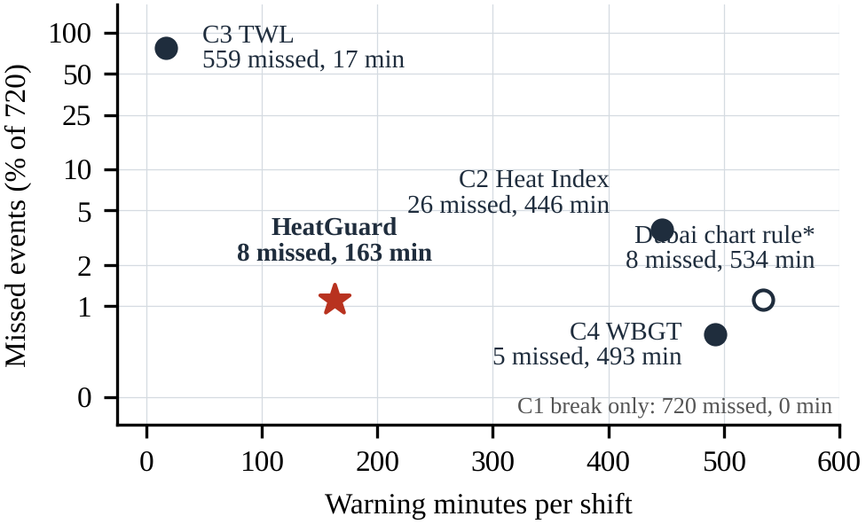

# HeatGuard

**A wearable heat-strain warning prototype for outdoor crews in Dubai.**

CSIT305 Research and Innovation Project · University of Wollongong in Dubai

[Open the demo file](docs/demo/heatguard_demo.html) · [Read the IEEE paper](docs/paper/heatguard_paper.pdf) · [Inspect the results](docs/results/v5_locked_2026-11-16/) · [Review submission evidence](docs/submission.md)

HeatGuard asks whether worker-specific alerts can reduce the time spent under a warning while retaining most early catches from environmental rules. Once a minute, the prototype uses weather and simulated wearable signals to estimate whether a worker may reach a dangerous core temperature within 30 minutes. If the heart-rate sensor drops out or freezes, the system switches to the Wet Bulb Globe Temperature (WBGT) rule.

> **Study scope.** The Dubai shifts, wearable readings and danger events are simulated. Historical Dubai weather drives the simulation. The results describe the prototype in that test environment and require validation on measured UAE workers before field use.

## Try the supervisor replay

Open [the saved HTML file](docs/demo/heatguard_demo.html) in a browser. From GitHub, download the file and open it locally. The replay works offline and does not need Python.

1. Pick a worker from the 12-person board or choose a shift story.
2. Jump to the first warning to see the worker's **STOP** display and the rules side by side.
3. Return to early in the shift and switch off or freeze the heart-rate sensor to see WBGT fallback.

## Main result

The [pre-registered v0.5 test](docs/preregistration_v5.md) used **4,000 held-out simulated shifts** on 2024 Dubai weather, with **720 danger events**. Every option kept the legal midday break. HeatGuard averaged **67% fewer warning minutes than WBGT**, with **8 missed events versus 5**. It met the pre-registered sensitivity margin in that run. The [exploratory stress tests](docs/results/v5_posthoc_2026-11-17/) broke that margin when worker differences were increased and in one smaller repeat.

| Warning policy | Missed events / 720 | Warning min / shift | False episodes / shift |
|---|---:|---:|---:|
| Midday break only | 720 | 0 | 0.00 |
| + Heat Index ≥ 40, NWS formula | 26 | 446 | 1.53 |
| + Thermal Work Limit | 559 | 17 | 0.23 |
| + WBGT, NIOSH limits | 5 | 493 | 1.61 |
| **+ HeatGuard** | **8** | **163** | **1.08** |



The model's strongest features and the danger label come from the same simulated physiology. A known fault can also keep warnings active after a heart-rate sensor recovers. These limitations matter when interpreting the results.

## What the measured data added

| Source | Use in the follow-up | What we observed |
|---|---|---|
| PROSPIE heat-chamber recordings | Fit one recovery parameter from measured heart rate and rectal temperature. Then train two warning models on matched simulated Dubai shifts. | Held-out lab error improved from 6.96 to 6.69 bpm. Both warning models missed 3 of 84 simulated events. |
| Western Australian mine-worker recordings | Compare recorded heart rate and core temperature with the calibrated Dubai simulation. | Six-hour mean heart rate was 80.6 bpm in the Australian group trace and 100.9 bpm in the simulation. |
| Dubai Airport weather station | Compare local station temperature with the ERA5 weather input. | Mean absolute difference was 1.117 °C over 731 matched morning hours. |

[Follow-up methods and limitations](docs/prospie_recovery.md) · [Original files, licences and download sources](data/external/README.md)

## Run and reproduce

Use Python 3.13 and Node.js. From the repository root:

```sh
python3.13 -m venv .venv
source .venv/bin/activate
python -m pip install -r requirements.txt
python -m pytest -q
node docs/demo/check_engine.js
python docs/validation/check-results.py
python run_v5.py smoke
```

The smoke command checks the pipeline on tiny synthetic weather fixtures. It writes to ignored local outputs. See [validation](docs/validation/README.md) for the suite status, interaction checks and logs.

<details>
<summary>Reproduce the locked simulation and the post-hoc checks</summary>

Run from a fresh clone. The simulation stages are compute-intensive. The final stage requires the pre-registration in Git and refuses to replace an existing local final-run record.

```sh
python run_v5.py data
python run_v5.py select
python run_v5.py final
```

Use [the post-hoc plan](docs/posthoc_plan_v5.md) and [saved report](docs/results/v5_posthoc_2026-11-17/) for the exploratory stress tests and fault diagnostic. With the v0.5 outputs in place, `python make_demo_data.py` rebuilds the replay. The earlier Week 8 Streamlit dashboard is in `dashboard.py`.

</details>

<details>
<summary>Reproduce the measured-data follow-up</summary>

```sh
python -m pip install openpyxl
OPENBLAS_NUM_THREADS=1 OMP_NUM_THREADS=1 python calibrate_hr_recovery.py data/external/prospie-lab/PROSPIE-original.xlsx --lab-only
OPENBLAS_NUM_THREADS=1 OMP_NUM_THREADS=1 python retrain_prospie.py
```

Results write to ignored local outputs. See [saved scores and configuration](docs/results/prospie_retrained/) for the archived run.

</details>

## Repository guide

| Path | Contents |
|---|---|
| [`heatguard/`](heatguard/) | Weather, simulated workers, wearable inputs, warning rules, models and evaluation |
| [`tests/`](tests/) and [validation](docs/validation/) | Regression tests, offline interactions and result verification |
| [`data/`](data/) | ERA5 weather inputs and source files used in the follow-up |
| [`docs/results/`](docs/results/) | Locked results, exploratory results and earlier runs |
| [`docs/paper/`](docs/paper/) and [`docs/demo/`](docs/demo/) | IEEE paper and standalone browser artefact |
| [Development milestones](docs/milestones.md) | Key changes with original commit references |
| [Evidence log](docs/evidence_log.md), [team contributions](CONTRIBUTIONS.md) and [AI use](docs/genai_log.md) | Project decisions, testing, ownership and prompt evidence |
