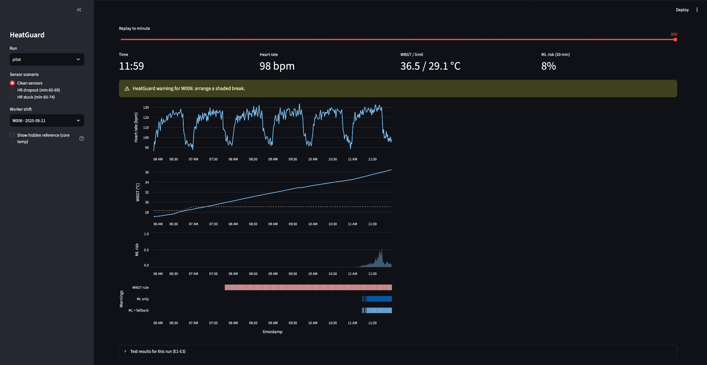
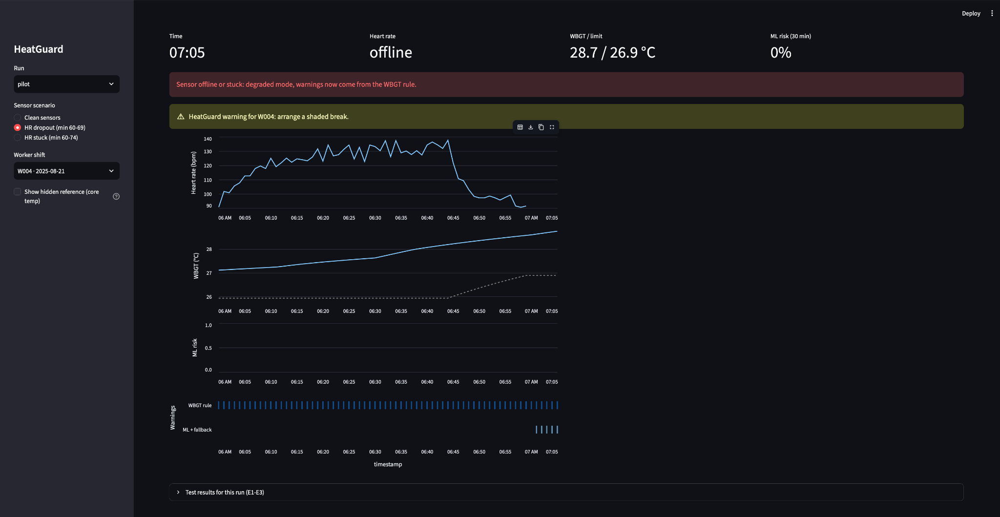
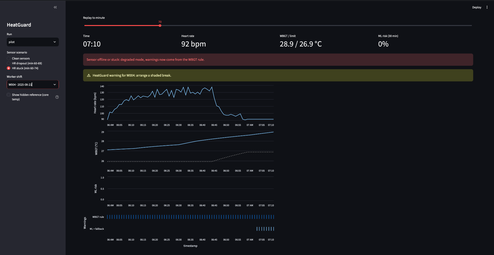
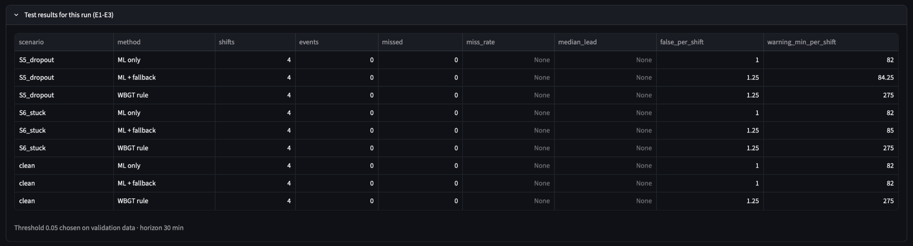

# HeatGuard — Week 8 Dashboard Usability Review

**Review date:** 10 November 2026  
**Method:** Individual heuristic evaluation using Nielsen's 10 usability heuristics. The Streamlit dashboard was run locally; the reviewer explored the clean-sensor, heart-rate (HR) dropout and HR-stuck scenarios and captured screenshots of the dashboard and results table. Source code (`dashboard.py`) was also checked for context.  
**Scope:** Usability of the research dashboard. This is *not* an assessment of clinical safety or predictive accuracy, and no external users participated.  
**Severity scale:** 0 = no usability problem; 1 = cosmetic; 2 = minor; 3 = major; 4 = critical/catastrophic.

## 1. Screenshots from the local dashboard run

### Evidence A — Clean-sensor dashboard

**Scenario:** Clean sensors, worker W006, 21 August 2025, replay at 11:59. The screen shows heart rate **98 bpm**, WBGT **36.5°C** against a **29.1°C** limit, and **8%** ML risk for the next 30 minutes. A visible yellow banner instructs the supervisor to arrange a shaded break. The charts and separate warning-policy timelines are available.

### Evidence B — HR dropout and fallback

**Scenario:** HR dropout (minutes 60–69), worker W004, 21 August 2025, replay at **07:05** (minute 65). The heart-rate field says **offline**. A red message explains that the system is in **degraded mode** and warnings now come from the WBGT rule. A yellow break warning remains visible. However, the prominent ML-risk metric still reads **0%**, without saying the ML output is unavailable or not the active warning source.

### Evidence C — Stuck HR reading and fallback

**Scenario:** HR stuck (minutes 60–74), worker W004, 21 August 2025, replay at **07:10** (minute 70). The screen reports degraded mode and WBGT fallback, but the heart-rate metric still displays **92 bpm** as a normal-looking number. A supervisor may not realise this displayed value is an unreliable stuck reading; the generic message does not distinguish the fault from a complete dropout.

### Evidence D — E1–E3 results table

**Run:** `pilot`. The table displays **4 shifts** and **0 danger events** for the shown clean, dropout and stuck scenarios. The `miss_rate` and `median_lead` cells are **None**. For the clean scenario, `false_per_shift` is **1.00** for ML only and **1.25** for the WBGT rule; `warning_min_per_shift` is **82** and **275**, respectively. These values describe this particular small pilot run; with **zero danger events**, the table cannot establish missed-event performance or warning lead time.

## 2. Four supervisor tasks from the evaluation guide

| Task | Observation | Outcome |
| --- | --- | --- |
| Find a worker shift with a danger event and identify the first warning. | This local `pilot` run showed **0 danger events** in the results table. No first-danger-event lead time could be measured from the captured run. | **Not assessable with this run**; a danger-event example would be needed. |
| Switch to HR dropout; identify what changed and why. | At minute 65, heart rate changed to **offline** and a degraded-mode banner identified **WBGT fallback** as the active warning source. | **Supported**, but the separate **0% ML risk** metric is ambiguous. |
| Decide whether the worker needs a break. | At 07:05 in the dropout scenario, and at 11:59 in the clean scenario, a yellow banner explicitly instructed **“arrange a shaded break.”** The requested minute-90 checkpoint was **not separately recorded**. | **Action visible at observed replay times**; exact minute-90 task not fully verified. |
| Find false alarms per shift by warning method. | Expand **“Test results for this run (E1–E3)”** and read `false_per_shift` for ML only, ML + fallback and WBGT rule. | **Successful**, although labels are technical and the table does not explain `None`. |

## 3. Nielsen's ten usability heuristics

| # | Heuristic | Observation / usability problem | Severity | Suggested improvement |
| --- | --- | --- | :---: | --- |
| 1 | **Visibility of system status** | Time, heart rate, WBGT, ML risk and fault banners are prominent. During HR dropout, however, ML risk remains at **0%** even while the dashboard states it is using WBGT fallback; the meaning of that percentage is unclear. | **3** | Show **“ML risk unavailable — WBGT fallback active”** or visibly mark the ML probability as inactive during fallback. |
| 2 | **Match between system and the real world** | Terms including **WBGT**, **ML risk**, **E1–E3** and `false_per_shift` assume technical knowledge. | **2** | Provide plain-language labels, for example **“Heat exposure (WBGT)”** and **“False warning episodes per shift,”** with short tooltips. |
| 3 | **User control and freedom** | The worker selector, scenario radio buttons and replay slider support exploring different situations. There is no quick control for jumping to the start of a fault or a warning. | **1** | Retain the replay slider and add optional **“Jump to fault”** and **“Jump to first warning”** shortcuts. |
| 4 | **Consistency and standards** | A yellow operational break warning can coexist with **0% ML risk** during fallback. The ML chart uses a **0–1** scale while the metric uses percentages. | **2** | State which warning policy is active, visually disable unavailable ML values, and express risk consistently as **0–100%**. |
| 5 | **Error prevention** | In the stuck-HR scenario, **92 bpm** appears as a normal metric even though the sensor is identified as faulty. Users could mistake it for a current trustworthy measurement. | **3** | Replace the number with **“92 bpm — stale/unreliable”** or **“Sensor reading unreliable”**; show its last valid timestamp if available. |
| 6 | **Recognition rather than recall** | The warning timelines help compare policies, but the WBGT limit is a dashed line without a visible direct legend, and colours alone are not enough to explain all lines. | **2** | Label actual WBGT and threshold directly; identify warning policies in the current-status summary. |
| 7 | **Flexibility and efficiency of use** | Only one worker shift is visible at a time. This is useful for a demo but inefficient for supervising multiple workers simultaneously. | **2** | Add an optional overview table of worker ID, latest warning, sensing status and priority, with drill-down to the existing charts. |
| 8 | **Aesthetic and minimalist design** | The current action appears near the top and is easy to find. Four large charts occupy most of the screen, making rapid scanning harder. | **1** | Keep the current warning and sensor status prominent; optionally collapse detailed research charts. |
| 9 | **Help users recognise, diagnose and recover from errors** | The red banner clearly announces degraded operation, but says **“offline or stuck”** for both failure types, so it does not identify the precise cause or how to restore sensing. | **2** | Specify **“HR disconnected”** or **“HR reading stuck”** and add a simple action such as **“Check device/connection.”** |
| 10 | **Help and documentation** | The results table shows raw headings such as `miss_rate` and unexplained **None** cells. In this pilot there are zero danger events, so missing lead-time/miss-rate values need context. | **2** | Show **“N/A — no danger events in this run”**, use readable headings, and provide a brief dashboard glossary. |

*Severity scores reflect the reviewer’s assessment of usability, not confirmed defects in the underlying prediction or fallback algorithms.*

## 4. Three highest-priority improvements

1. **Severity 3 — Make the ML-risk status unambiguous during fallback (heuristics 1 and 4).** At minute 65, HR is offline and the dashboard says WBGT fallback is active, but the ML-risk metric still shows **0%**. Clearly label the ML prediction as unavailable/inactive during degraded operation so it cannot be read as proof of safety.
2. **Severity 3 — Mark stuck HR readings as unreliable (heuristic 5).** At minute 70 of the stuck-sensor scenario, **92 bpm** is shown without an inline stale-data label. Identify the value as unreliable or hide it while the stuck fault is active.
3. **Severity 2 — Explain unavailable results and technical table headings (heuristic 10).** The pilot has **zero danger events** yet displays `missed = 0` and `None` for rate/lead-time outputs. Use **“N/A — no events”** where appropriate and explain that zero missed events is not a measured detection success when there were no events to catch.

## 5. Positive findings

- The dashboard launched successfully in a local Streamlit session and allowed switching sensor scenarios and worker shifts.
- The current time and four primary metrics are prominent.
- In the HR-dropout scenario, the missing HR reading is explicitly shown as **offline**.
- In both captured faulty-sensor scenarios, a separate degraded-mode banner explains that the **WBGT rule** is the fallback warning source.
- The break instruction is written in plain language and is easy to notice.
- Warning timelines separate **WBGT rule**, **ML only** and **ML + fallback**.
- The results table is accessible in an expandable section, keeping detailed evaluation numbers out of the initial dashboard view.

## 6. Conclusion and limitations

The local dashboard supports the core usability tasks of selecting a worker, replaying a shift, inspecting trends and recognising degraded sensing. Its most important usability risk is **ambiguous presentation of measurements and predictions when the sensor is faulty**. The proposed changes focus on communication and labelling; this review **does not recommend changing model logic**.

This was one individual's heuristic inspection, not a participant-based usability study. The screenshots document specific replay positions, not every dashboard state. In particular, **the four-shift pilot has no danger events**, so it cannot be used to judge early-warning lead time or missed-event performance. No timing or success-rate claims about other users were collected.

**AI assistance disclosure:** ChatGPT was used to structure and word this report, interpret the four screenshots and cross-check the dashboard labels against the repository source code. The dashboard was run and the screenshots captured locally by the reviewer. Findings and severity ratings should be checked before the report is committed; record this assistance in the project's GenAI log.

**Heuristic reference:** J. Nielsen, “Enhancing the explanatory power of usability heuristics,” *Proceedings of CHI ’94*, 1994, pp. 152–158. DOI: [10.1145/191666.191729](https://doi.org/10.1145/191666.191729).
